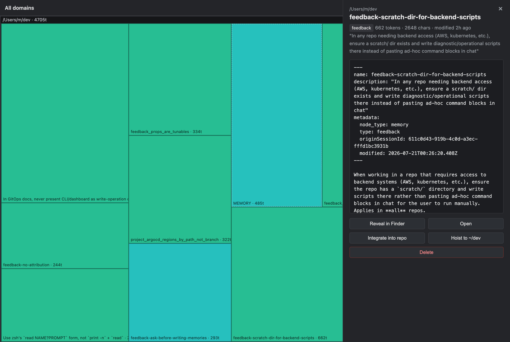

# Mem GUI

**A desktop treemap for the memories Claude Code keeps about you.**

Claude Code quietly accumulates memory files across every project you work in —
tucked away under `~/.claude/projects/*/memory/` as little Markdown notes with
frontmatter. Over time you build up dozens of them, and there's no good way to
see what's in there, what's gone stale, or what's silently eating your context
budget. Mem GUI gives that hidden store a window.



Every memory is a tile. **Area is token cost** — the bigger the box, the more of
your context window it spends. **Color is recency** — warm tiles were touched
recently. Click any tile to read it, then keep, relocate, or delete it.

---

## Why

Memories are cheap to create and easy to forget. They're scattered one directory
per project, named after escaped filesystem paths, and invisible until they show
up in a prompt. The questions you can't answer at a glance are exactly the ones
that matter:

- **Which memories are costing me the most tokens?** → the largest tiles.
- **What have I not looked at in months?** → the coolest, bluest tiles.
- **Is this note really project-specific, or should it apply everywhere?** →
  open it and _hoist_ it up to a broader root, or _move_ it to whichever project
  it actually belongs to.
- **Should this live in the repo's docs instead of a private memory?** → let
  Claude _integrate_ it into the right file.

## Features

- **Squarified treemap** grouped by project domain, sized by estimated token
  cost and colored on a recency gradient (red = fresh, blue = old).
- **Drill down** — click a domain to zoom into just its memories, breadcrumb
  back out.
- **Inspect panel** — full file contents, type badge, token/char counts, and
  last-modified time for any memory.
- **Reveal in Finder / Open** — jump straight to the file on disk.
- **Integrate into repo** — a read-only `claude` sub-process proposes the single
  best doc in the memory's own project to fold the note into (README, a doc
  under `docs/`, etc.). Nothing is written until you review the proposal and
  confirm; the write lands in one Markdown file, reversible via the repo's git
  history.
- **Move to…** — deterministically relocate a memory as-is into any other
  project's memory store: pick one of the domains already in the treemap, or
  name any directory on disk. No LLM, no arbitrary write target — the
  destination only selects _which_ store, and the write always lands at
  `~/.claude/projects/<domain>/memory/`. Both ends' `MEMORY.md` indexes are kept
  in sync, and a filename collision is refused rather than overwritten.
- **Hoist** — the same move in one click, with the destination pre-set to your
  **default hoist directory** (`~` out of the box, configurable via **⚙**).
  Point it at a broad root so hoisted memories apply across every project
  instead of one.
- **Delete** — with confirmation, and the dangling entry is stripped from that
  domain's `MEMORY.md` index automatically.

## Settings

**⚙** in the top bar opens settings, persisted to `~/.claude/mem-gui.json`:

| Setting                 | Default | What it does                                                                                   |
| ----------------------- | ------- | ---------------------------------------------------------------------------------------------- |
| Default hoist directory | `~`     | The project directory the one-click **Hoist** button targets. Kept as typed, so `~` stays `~`. |

The directory is validated when you save — a path that doesn't exist is rejected
there and then, rather than failing on every later hoist.

A few things worth knowing about that file:

- **It's written only when you save.** Until you change something in **⚙**, no
  file exists and the app runs on the defaults in `src/settings.ts`.
- **A missing or malformed file is not an error.** Anything unparseable falls
  back to defaults silently, so hand-editing it can't lock you out of the app —
  worst case a bad edit is ignored.
- **Claude Code does not read it.** It sits in `~/.claude` only so the app's
  write permission can stay scoped to a single tree (see _Permissions_ below).
  Claude Code loads its config by specific filename — `settings.json`,
  `CLAUDE.md`, `keybindings.json` — and memory recall only walks
  `~/.claude/projects/*/memory/*.md`, so `mem-gui.json` is inert to it.

Note that `~` expands to your home directory, whose memory store Claude Code
only consults when run with your home directory as the cwd. If you always work
inside `~/dev/...`, point this at `~/dev` instead so hoisted memories actually
apply across those projects.

## How it works

Mem GUI is a [Deno desktop](https://docs.deno.com/) app: a native webview window
whose page talks to a small Deno backend over typed bindings — no browser tab,
no separate server to manage.

- `src/scanner.ts` walks `~/.claude/projects/*/memory/`, parses each memory's
  frontmatter, estimates its token cost, and resolves each project's cryptic
  escaped-path domain name back to a real path by reading the `cwd` out of one
  of its session transcripts.
- `src/migrate.ts` implements the two relocation flows — the LLM-assisted
  _integrate_ (structurally read-only: tools locked to `Read`/`Glob`/`Grep`, MCP
  disabled, so the proposal step _cannot_ write) and the deterministic _move_.
- `src/paths.ts` owns the escaped-path ↔ domain mapping in the exact direction
  (real path → domain id) and validates any directory you name.
- `src/settings.ts` reads/writes `~/.claude/mem-gui.json`, falling back to
  defaults whenever it's missing or malformed.
- `public/treemap.js` renders the squarified layout and the inspect panel.
- `main.ts` wires the bindings up and guards every filesystem action behind a
  check that the path lives inside the managed memory store.

Every write is scoped, reviewable, and reversible — nothing is mutated as a
silent side effect of something else.

## Getting started

**Prerequisites:** [Deno](https://deno.com/) 2.8+ (this uses the experimental
`deno desktop` runtime) and, optionally, the `claude` CLI on your `PATH` for the
_Integrate into repo_ feature.

```bash
git clone https://github.com/johnstonmatt/mem-gui.git
cd mem-gui
deno task dev
```

The window opens on your memory store automatically. Hit **⟳** any time to
rescan.

### Build a standalone macOS app

```bash
deno task build:mac
# → dist/MemGui.app
```

### Checks

```bash
deno task checks   # everything CI runs: fmt --check, lint, type check, tests
deno task test     # just the tests
deno fmt           # fix formatting in place
```

The same steps run on every push and pull request via
`.github/workflows/ci.yml`, as separate steps so a failure names itself. CI also
greps for remote (`jsr:` / `npm:` / `https:`) imports and fails on any — see the
warning below.

> [!IMPORTANT]
> **This app has no dependencies on purpose.** Pulling any remote module into
> the `deno desktop` module graph silently breaks the webview binding channel:
> every `win.bind()` handler ends up unregistered, so the page's first call
> fails with `No callback bound for: …` and the window comes up empty. Nothing
> fails at build time — only at runtime, inside the window. `src/paths.ts`
> hand-rolls its path helpers for exactly this reason, and the tests hand-roll
> their assertions to keep the rule simple. Verified against deno 2.9.0 / laufey
> 0.4.0.

`deno task build:mac` is deliberately not in CI: it needs macOS and downloads
the experimental `deno desktop` runtime.

## Permissions

The app runs with a deliberately narrow permission set (see `deno.jsonc`):

| Scope | Grant                | Why                                                                          |
| ----- | -------------------- | ---------------------------------------------------------------------------- |
| Read  | `$HOME`              | scan the memory store, and check that a move destination is a real directory |
| Write | `~/.claude`, `~/dev` | manage the memory store and the settings file                                |
| Run   | `open`, `claude`     | reveal/open files, and the read-only integrate proposal                      |
| Net   | `127.0.0.1`          | serve the local page to the webview                                          |

Read is broad because a move destination can be any directory and has to be
verified before use; **write is not** — apart from `~/.claude/mem-gui.json`,
nothing outside `~/.claude/projects/*/memory/` is ever touched by a move, and
path guards in `main.ts` and `src/migrate.ts` enforce it at the boundary.
(_Integrate_ is the one flow that writes into a repo, which is why `~/dev` is
also writable; point that grant elsewhere if your projects live somewhere else.)

## Project layout

```
main.ts              # bindings + local asset server + path guards
src/
  scanner.ts         # walk the memory store, parse frontmatter, resolve domains
  migrate.ts         # integrate (LLM-assisted) and move (deterministic) flows
  paths.ts           # project dir -> domain id mapping + destination validation
  settings.ts        # ~/.claude/mem-gui.json (default hoist directory)
  types.ts           # Domain / MemoryFile shapes
  *_test.ts          # unit tests, run against a throwaway $HOME
  test_helpers.ts    # temp-HOME harness + minimal assertions
public/
  index.html         # window shell
  styles.css         # dark treemap theme
  treemap.js         # squarified layout, inspect panel, move + settings UI
scripts/
  setup_release.ts   # interactive one-time setup of the Apple release secrets
  set_codesign_identity.ts  # swaps in the real Developer ID at release time
deno.jsonc           # version, tasks, desktop config, permission scopes
release-please-config.json  # conventional-commits -> release PRs
.github/workflows/
  ci.yml             # fmt, lint, type check, tests, no-remote-deps guard
  release.yml        # release PR, then build + sign + notarize the .app
```

## License

MIT
