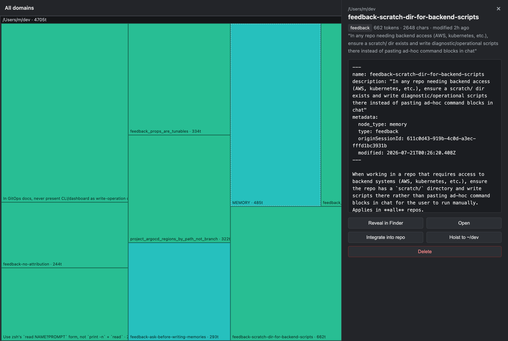

# Mem GUI

**A desktop treemap for the memories Claude Code keeps about you.**

Claude Code quietly accumulates memory files across every project you work in —
tucked away under `~/.claude/projects/*/memory/` as little Markdown notes with
frontmatter. Over time you build up dozens of them, and there's no good way to
see what's in there, what's gone stale, or what's silently eating your context
budget. Mem GUI gives that hidden store a window.



Every memory is a tile. **Area is token cost** — the bigger the box, the more of
your context window it spends. **Color is recency** — warm tiles were touched
recently. Click any tile to read it, then keep, relocate, or delete it.

## Install

**macOS (Apple Silicon):** grab the signed, notarized `.app` from the
[latest release](https://github.com/johnstonmatt/mem-gui/releases/latest), unzip
it, and drag `MemGui.app` to `/Applications` (or just double-click it in place)
— Gatekeeper accepts it as-is, no right-click-to-open workaround needed.

No Deno install required for this path — that's only needed to build from source
or run in dev mode, covered under [Getting started](#getting-started).

### Updating

**⚙ → Check for Updates…** (also in the **Mem GUI** menu) compares your version
with the latest GitHub release. **Install update** downloads it, checks that
it's the expected version and that it's Developer ID signed and notarized, then
quits Mem GUI, replaces `/Applications/MemGui.app`, and relaunches it. Releases
before 0.2 have no updater, so install the first one with it by hand.

---

## Why

Memories are cheap to create and easy to forget. They're scattered one directory
per project, named after escaped filesystem paths, and invisible until they show
up in a prompt. The questions you can't answer at a glance are exactly the ones
that matter:

- **Which memories are costing me the most tokens?** → the largest tiles.
- **What have I not looked at in months?** → the coolest, bluest tiles.
- **Is this note really project-specific, or should it apply everywhere?** →
  _hoist_ it so every coding agent follows it in every project, or _move_ it to
  the project it actually belongs to.
- **Should this live in the repo's docs instead of a private memory?** → let
  Claude _integrate_ it into the right file.

## Features

- **Squarified treemap** rooted at `~`, sized by estimated token cost and
  colored on a recency gradient (red = fresh, blue = old). `~`'s own tiles are
  your hoisted instructions, which apply to everything below. Stores nest under
  the nearest store whose folder contains theirs, and a store with stores inside
  it is **striped**: its memories load only in sessions started in exactly that
  folder and never reach the projects inside it, so it's almost always a
  misplaced memory worth hoisting or moving.
- **Drill down** — click any box to zoom into it; the breadcrumb (`~ › …`) leads
  back out.
- **Inspect panel** — full file contents, type badge, token/char counts,
  last-modified time, and where the memory actually loads.
- **Reveal in Finder / Open** — jump straight to the file on disk.
- **Integrate into repo** — a read-only `claude` sub-process proposes the single
  best doc in the memory's own project to fold the note into (README, a doc
  under `docs/`, or the root `AGENTS.md` for guidance aimed at coding agents).
  Nothing is written until you review the proposal and confirm, and the write is
  reversible via the repo's git history. When the target is `AGENTS.md` and the
  repo also has a `CLAUDE.md` that doesn't import it, an `@AGENTS.md` line is
  added there too, so every agent reads it.
- **Hoist** — one click moves a memory up to `~`: the one instructions file
  every coding agent on the machine reads in every project (see
  [Shared instructions](#shared-instructions)). The inspect panel then shows it
  in `~`, with **Undo** to put the memory back exactly as it was. Hoist only
  asks first when it would also change an agent's config folder, which happens
  the first time and when a new agent folder appears. In `~`, Delete removes an
  instruction for every agent and Open edits the file.
- **Move to…** — deterministically relocate a memory as-is into another memory
  store: pick one already in the treemap, or name a directory (inside a repo,
  that means the repo's store). Both `MEMORY.md` indexes are kept in sync, and a
  filename collision is refused. Moving never widens a memory's reach; see
  _Where memories load_ below.
- **Delete** — with confirmation, and the dangling entry is stripped from that
  domain's `MEMORY.md` index automatically.

Claude keeps creating and updating memories as it works; none of this changes
that. Its auto memory also skips anything the loaded instruction files already
say, and the shared file is one of them, so a hoisted instruction isn't
re-learned as a memory.

## Where memories load

Claude Code keeps one memory store per project and loads only that store at
session start ([docs](https://code.claude.com/docs/en/memory#storage-location)):

- **Inside a git repo**, the store is keyed by the repo root, so every
  subdirectory and linked worktree of the repo shares it.
- **Outside a repo**, it's keyed by the directory the session started in.
- **Stores don't inherit.** A session in `~/dev/app` never reads the store for
  `~/dev`, or the one for the home folder itself (shown as
  `~ · sessions started here`, since plain `~` is the shared instructions).
- **A shared `autoMemoryDirectory`** in user settings replaces every per-project
  store with one directory; the per-project stores then never load.

The inspect panel says which of these applies to each memory, including stores
whose directory no longer exists. Only the `MEMORY.md` index loads at startup;
Claude reads individual memory files on demand. Instruction files load in full,
which is another reason standing rules belong in them.

## Shared instructions

Hoisted instructions — the treemap's `~` group — live in exactly one file,
`~/.agents/AGENTS.md`, as sections between `<!-- mem-gui:begin … -->` and
`<!-- mem-gui:end … -->` markers. Every agent config folder points at it once:

| Agent       | Points at the shared file by                                                                                                                      |
| ----------- | ------------------------------------------------------------------------------------------------------------------------------------------------- |
| Claude Code | an `@~/.agents/AGENTS.md` line in the folder's `CLAUDE.md` ([user-level imports](https://code.claude.com/docs/en/memory#import-additional-files)) |
| Codex       | the folder's `AGENTS.md` being a symlink to it (Codex reads that file as-is and has no imports)                                                   |

So editing or deleting an instruction in that one file changes it for every
agent at once, and nothing needs syncing. Edit it in any editor; text outside
the markers still loads, it just shows as one "Other shared instructions" tile.

The pointers are set up on the first hoist and checked on every scan. A folder
that appears later, such as a new Ori profile, shows as not reading the shared
file yet, with **Fix links** to point it there. Mem GUI never overwrites
anything to do this:

- An empty `AGENTS.md` is replaced by the link; one with its own text has that
  text moved into the shared file first (listed before you confirm).
- An `AGENTS.md` that's already a symlink elsewhere blocks hoisting until you
  move what it holds into the shared file.
- If an editor saved through the link by replacing the file, leaving a copy,
  that's reported rather than merged, so nothing is duplicated.
- A non-empty `AGENTS.override.md` makes Codex read it instead of `AGENTS.md`;
  that's flagged, since shared instructions won't load there until it's gone.

### Agents and profiles

Every agent config folder on the machine is found and treated as one:

| Found from                                                         | Claude Code           | Codex                |
| ------------------------------------------------------------------ | --------------------- | -------------------- |
| The default location                                               | `~/.claude`           | `~/.codex`           |
| An environment variable                                            | `CLAUDE_CONFIG_DIR`   | `CODEX_HOME`         |
| [Ori](https://openrouter.ai/ori) profiles (`~/.ori/profiles.json`) | e.g. `~/.claude-work` | e.g. `~/.codex-work` |

The treemap shows memory stores from every Claude Code folder, labelling any
outside `~/.claude`. Things worth knowing:

- **Ori Harness** (`ori claude`, `ori codex`) runs the same agents, so it's
  covered. **Ori Code**, Ori's own agent, doesn't document which instruction
  files it reads, so it isn't pointed at the shared file.
- **Scripts that run an agent with its user config switched off** won't see
  shared instructions, by design. `codex exec --ignore-user-config` is not one
  of them: that flag skips `config.toml` but Codex still reads its `AGENTS.md`.
- **There's no folder-scoped hoist.** A parent folder's `CLAUDE.md` would reach
  Claude Code only (Codex never reads above a repo's root), and its presence
  stops Claude Code reading `AGENTS.md` in repos below it that have no
  `CLAUDE.md` of their own.
- **Environment variables only reach the app when it's started from a shell**
  (`deno task dev`); the `.app` launched from Finder doesn't inherit your shell
  environment. Ori profiles and the default folders are found either way.
- Claude's Cowork desktop sessions skip user-level imports that point outside
  the working directory; terminal sessions follow them.
- Codex's own memories are generated state its docs say not to edit by hand, so
  they aren't shown.

### Dotfiles

`~/.agents/AGENTS.md` starts as a plain file. To version it, move it into your
dotfiles and link it back (with GNU Stow, as `<package>/.agents/AGENTS.md`); Mem
GUI writes through the link. Keep `~/.agents` itself a real directory so stow
links the file rather than folding the folder, and don't manage a Codex
`AGENTS.md` in dotfiles too: it must stay the link to the shared file.

## How it works

Mem GUI is a [Deno desktop](https://docs.deno.com/) app: a native webview window
whose page talks to a small Deno backend over typed bindings — no browser tab,
no separate server to manage.

- `src/homes.ts` finds agent config folders (defaults, environment variables,
  Ori profiles) and the memory stores inside the Claude Code ones.
- `src/scanner.ts` parses each memory's frontmatter, estimates its token cost,
  and resolves each store's escaped name back to a real directory: from a
  session transcript's `cwd` (mapped to its repo root), else by searching the
  filesystem for the path that escapes to it.
- `src/paths.ts` owns the store naming rule (every character that isn't a letter
  or digit becomes `-`, so `/Users/m/.lockin` is `-Users-m--lockin`), repo-root
  and worktree resolution, and validation of any directory you name.
- `src/migrate.ts` implements _integrate_ (structurally read-only proposal:
  tools locked to `Read`/`Glob`/`Grep`, MCP disabled) and the deterministic
  _move_.
- `src/hoist.ts` owns the shared instructions file: hoisting into it, pointing
  every agent folder at it, and deleting sections.
- `public/tree.js` builds the `~` tree; `public/treemap.js` renders the
  squarified layout and the inspect panel.
- `main.ts` wires the bindings up and guards every memory action behind a check
  that the path lives directly inside a known store.

Every write is scoped, reviewable, and reversible — nothing is mutated as a
silent side effect of something else.

## Getting started

**Prerequisites:** [Deno](https://deno.com/) 2.8+ (this uses the experimental
`deno desktop` runtime) and, optionally, the `claude` CLI on your `PATH` for the
_Integrate into repo_ feature.

```bash
git clone https://github.com/johnstonmatt/mem-gui.git
cd mem-gui
deno task dev
```

The window opens on your memory stores automatically. Hit **⟳** any time to
rescan.

### Build a standalone macOS app

```bash
deno task package:mac   # → dist/MemGui.app, ad-hoc signed
deno task install       # build, then install to /Applications
```

`package:mac` runs `scripts/package_app.zsh`: `deno desktop` builds the app
(`deno task build:mac`), then the script writes the version into `Info.plist`,
adds the installer the updater runs, and re-signs the bundle. Set
`CODESIGN_IDENTITY` to a Developer ID to sign it as a release is signed.

### Checks

```bash
deno task checks   # everything CI runs: fmt --check, lint, type check, tests
deno task test     # just the tests
deno fmt           # fix formatting in place
```

The same steps run on every push and pull request via
`.github/workflows/ci.yml`, as separate steps so a failure names itself. CI also
greps for remote (`jsr:` / `npm:` / `https:`) imports and fails on any — see the
warning below.

> [!IMPORTANT]
> **This app has no dependencies on purpose.** Pulling any remote module into
> the `deno desktop` module graph silently breaks the webview binding channel:
> every `win.bind()` handler ends up unregistered, so the page's first call
> fails with `No callback bound for: …` and the window comes up empty. Nothing
> fails at build time — only at runtime, inside the window. `src/paths.ts`
> hand-rolls its path helpers for exactly this reason, and the tests hand-roll
> their assertions to keep the rule simple. Verified against deno 2.9.0 / laufey
> 0.4.0.

A second CI job packages the app on macOS, ad-hoc signed, and verifies the
bundle, so a broken build is caught on the PR rather than at release.

## Releases

Releases are built by GitHub Actions and published as a Developer ID signed,
notarized `.app` zip on the GitHub release.

- `.github/workflows/release.yml` uses
  [release-please](https://github.com/googleapis/release-please). It keeps a
  release PR open from
  [conventional commits](https://www.conventionalcommits.org) on `main`
  (`feat:`, `fix:` and so on). Merging that PR bumps the version in
  `deno.jsonc`, updates `CHANGELOG.md`, tags the release, then tests, builds,
  signs, notarizes and attaches the app.
- The version comes from the commits: `fix:` bumps the patch, `feat:` the minor.
  Before 1.0, breaking changes (`feat!:` or a `BREAKING CHANGE:` footer) bump
  the minor too, because of `bump-minor-pre-major`. To choose a version
  yourself, such as 1.0.0, add a `Release-As: 1.0.0` footer to a commit that
  lands on `main`, and the release PR switches to that version.
- The release workflow refuses to run until the Apple signing secrets are set.
  Run `deno task setup:release` once (needs the `gh` CLI). It checks your
  Developer ID `.p12` and App Store Connect API key with the same tools CI uses
  before storing them as repository secrets.

## Permissions

`deno task dev` runs with a narrow permission set (see `deno.jsonc`):

| Scope | Grant                                     | Why                                                                    |
| ----- | ----------------------------------------- | ---------------------------------------------------------------------- |
| Read  | `$HOME`                                   | scan agent folders and memory stores, check move destinations          |
| Write | `$HOME`                                   | memory stores and instruction files in any agent folder, and Integrate |
| Env   | `HOME`, `CLAUDE_CONFIG_DIR`, `CODEX_HOME` | find agent folders                                                     |
| Run   | `open`, `claude`                          | reveal/open files, and the read-only integrate proposal                |
| Net   | `127.0.0.1`, `api.github.com`             | serve the local page to the webview, and check for updates             |

**The built app can't scope the filesystem grants that way, and doesn't pretend
to.** Deno bakes permission paths into the binary at build time, with `$HOME`
expanded as it does so, so a release built on CI would ship permitted to read
the runner's home and nobody else's — v0.1.1 shipped exactly that and opened to
an empty window on every machine but the build machine. There is no
runtime-resolved form: `--allow-read=~/x` is stored literally and never
expanded, granting nothing. So `build:mac` uses unscoped `--allow-read` and
`--allow-write`, and keeps the narrow `--allow-run` / `--allow-env` /
`--allow-net` grants, which don't depend on paths.

The built app also has the updater's grants: network access to `api.github.com`,
`github.com` and `release-assets.githubusercontent.com`, and permission to run
`ditto`, `codesign`, `spctl`, `plutil` and `zsh`, which runs the downloaded
release's installer. Running `zsh` amounts to running anything, which unscoped
`--allow-write` already allows.

That costs less than it sounds, because the path scoping was never the control:
**`main.ts` gates every memory action on the path living directly inside a known
store**, and that's what actually holds. A move touches nothing outside known
stores and refuses collisions. Hoist writes only `~/.agents/AGENTS.md` and each
agent folder's pointer to it (a `CLAUDE.md` import line, a Codex `AGENTS.md`
link), and never replaces a file with text in it without moving that text into
the shared file first. _Integrate_ writes only the Markdown file you approve,
plus the `@AGENTS.md` line it shows you.

## Project layout

```
main.ts              # bindings + local asset server + path guards
src/
  homes.ts           # agent config folders (defaults, env, Ori profiles) + stores
  scanner.ts         # parse memories, resolve each store's directory and scope
  migrate.ts         # integrate (LLM-assisted) and move (deterministic) flows
  hoist.ts           # the shared instructions file and every agent's pointer to it
  paths.ts           # store naming, repo/worktree roots, directory validation
  update.ts          # check GitHub for a release, download, verify, hand off to install.zsh
  types.ts           # Domain / MemoryFile / StoreScope shapes
  *_test.ts          # unit tests, run against a throwaway $HOME
  test_helpers.ts    # temp-HOME harness + minimal assertions
public/
  index.html         # window shell
  styles.css         # dark treemap theme
  tree.js            # the ~ tree: nesting by folder, which stores are striped
  treemap.js         # squarified layout, inspect panel, hoist + move UI
scripts/
  package_app.zsh    # build, set the Info.plist version, add install.zsh, re-sign
  install.zsh        # install a built app to /Applications; ships inside the app
  setup_release.ts   # interactive one-time setup of the Apple release secrets
  set_codesign_identity.ts  # swaps in the real Developer ID for signed builds
deno.jsonc           # version, tasks, desktop config, permission scopes
release-please-config.json  # conventional-commits -> release PRs
.github/
  entitlements.plist # allow-jit — V8 can't start under Hardened Runtime without it
  workflows/
    ci.yml           # fmt, lint, type check, tests, no-remote-deps guard, package
    release.yml      # release PR, then test + build + sign + notarize the .app
```

## License

MIT
